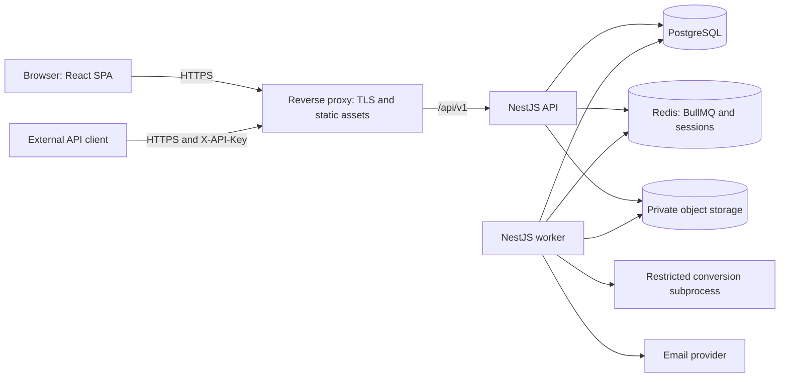
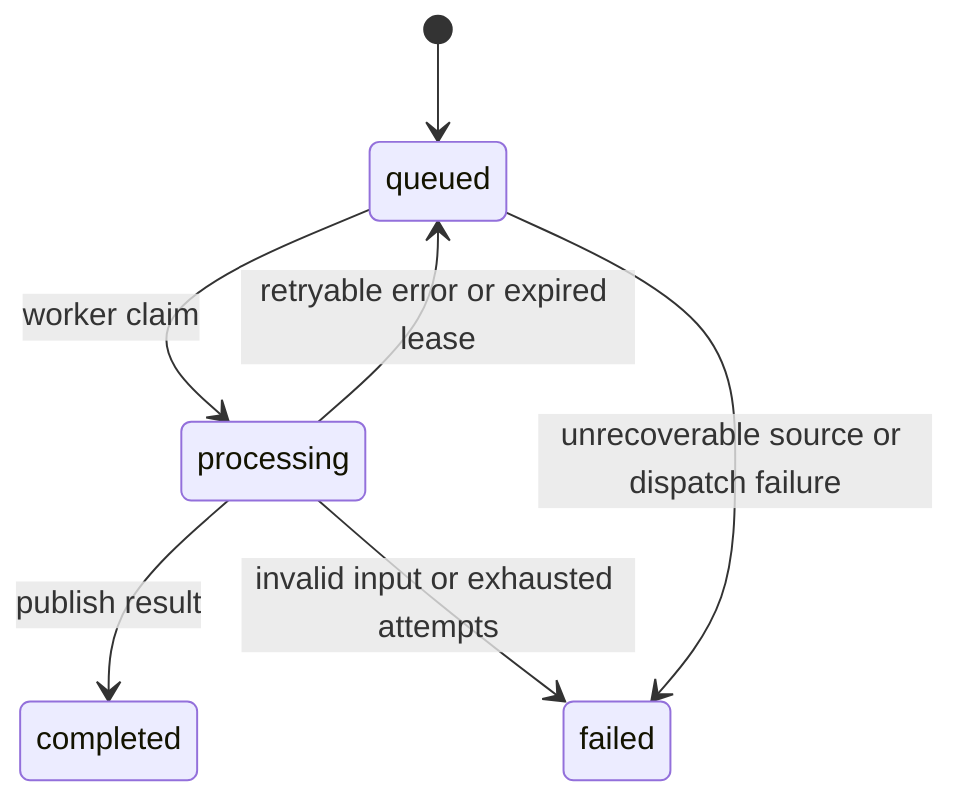

# File Converter SaaS Architecture

## 1. Purpose and scope

This proposal is based on `technical-task.md`, including its selected technology stack and MVP requirements. It describes the target implementation; the repository currently has frontend layout/routing, local file/target selection, conversion UI states behind an injectable frontend gateway (controlled test responses only), validated email authentication and account/profile/settings/API-key interfaces behind frontend gateways, pre-launch API documentation, and backend bootstrap. Ordinary auth routes send no credentials; development-only fixtures exercise session, verification and recovery states without real authentication or email delivery. Server-backed product workflows and the generated-contract transport mapping remain pending. Recommendations embedded in the specification are design input; the current user task determines implementation scope.

The MVP supports JPG ↔ PNG and DOCX → PDF, one free successful guest conversion without registration, email authentication for subsequent conversions, account settings, saved files, temporary downloads, API keys, and a public REST API. Guest access is a first-party web trial; third-party API integrations still require an API key. PDF → DOCX, Telegram authentication, billing, and additional formats remain future extensions.

**Recommendation: an npm-workspaces monorepo containing a React SPA and a modular NestJS backend, with separate API and worker entry points.** PostgreSQL owns persistent application state, Redis/BullMQ transports background work, and private S3-compatible storage holds file contents.

This preserves a single backend codebase and database while allowing conversion capacity to grow independently. Kubernetes, a service mesh, event sourcing, CQRS, and separate databases per module are unnecessary for the MVP.

## 2. Runtime topology



| Component | Responsibility | Deployment unit |
| --- | --- | --- |
| Web | Pages, forms, upload progress, status polling | Static Vite build served by the proxy |
| API | Authentication, authorization, validation, file streaming, job submission | Node.js container |
| Worker | Conversion orchestration, retries, email delivery, scheduled cleanup | Independently scalable Node.js container |
| Conversion subprocess | Sharp or LibreOffice execution against untrusted files | Restricted child process inside the worker sandbox boundary |
| PostgreSQL | Users, jobs, file metadata, keys, durable background intents | Persistent database |
| Redis | Queues, expiring sessions, distributed request limits | Private persistent service |
| Object storage | Original inputs and converted outputs | Local MinIO; production S3 or R2 |
| Email provider | Verification and password recovery messages | External SMTP/API service behind an adapter |

Only the reverse proxy exposes public application ports. Database, Redis, worker, and local storage administration endpoints remain private. The worker has no public HTTP application interface.

## 3. Repository and folder structure

Use npm workspaces and a single lockfile. Keep one backend workspace with two build targets; do not duplicate modules between separate API and worker projects.

```text
Converter/
├── apps/
│   ├── web/
│   │   ├── src/
│   │   │   ├── app/                  # Router, providers, global styles
│   │   │   ├── pages/                # Converter, account, files, auth, API docs
│   │   │   ├── features/
│   │   │   │   ├── auth/
│   │   │   │   ├── converter/
│   │   │   │   ├── account/
│   │   │   │   ├── files/
│   │   │   │   └── api-keys/
│   │   │   ├── shared/
│   │   │   │   ├── api/              # Axios client and generated API types
│   │   │   │   ├── ui/               # Reusable accessible components
│   │   │   │   └── lib/              # Small framework-independent helpers
│   │   │   └── main.tsx
│   │   ├── public/
│   │   ├── test-fixtures/            # Development-only controlled UI entry, excluded from production
│   │   └── package.json
│   └── backend/
│       ├── src/
│       │   ├── entrypoints/
│       │   │   ├── api.main.ts
│       │   │   └── worker.main.ts
│       │   ├── api.module.ts
│       │   ├── worker.module.ts
│       │   ├── modules/
│       │   │   ├── auth/
│       │   │   ├── users/
│       │   │   ├── api-keys/
│       │   │   ├── conversions/
│       │   │   │   ├── conversions.module.ts
│       │   │   │   ├── conversions.controller.ts
│       │   │   │   ├── conversions.service.ts
│       │   │   │   ├── conversion.processor.ts
│       │   │   │   ├── converter.port.ts
│       │   │   │   ├── converter.registry.ts
│       │   │   │   ├── adapters/     # Sharp and LibreOffice adapters
│       │   │   │   ├── dto/
│       │   │   │   └── policies/     # Allowed transitions and retention rules
│       │   │   ├── files/
│       │   │   └── notifications/
│       │   ├── infrastructure/
│       │   │   ├── database/         # Prisma lifecycle and database access
│       │   │   ├── storage/          # StoragePort and S3 adapter
│       │   │   ├── queue/            # BullMQ setup and durable dispatch
│       │   │   ├── sessions/
│       │   │   └── config/           # Validated environment configuration
│       │   └── common/               # Principal, guards, error filter, request ID
│       ├── prisma/
│       │   ├── schema.prisma
│       │   └── migrations/
│       ├── test/                     # Integration tests
│       ├── tsconfig.api.json
│       ├── tsconfig.worker.json
│       └── package.json
├── packages/
│   └── contracts/                    # Versioned OpenAPI artifact, generated types
├── tests/
│   ├── lint/                        # ESLint configuration regression tests
│   └── e2e/                         # Playwright and safe conversion fixtures
├── infra/
│   ├── docker/                      # Proxy, API and worker Dockerfiles
│   ├── proxy/                       # TLS/proxy routing configuration
│   ├── compose.yaml                 # Local PostgreSQL, Redis, MinIO, mail sink
│   └── compose.production.yaml       # Production deployment definition
├── .github/workflows/ci.yml
├── .env.example                     # Names and harmless defaults only
├── package.json
├── package-lock.json
├── docs/
│   ├── technical-task.md
│   ├── architecture.md
│   ├── TECH-STACK.md
│   ├── implementation-plan.md
│   └── progress.md
├── AGENTS.md
├── DESIGN.md
└── README.md
```

Colocate unit tests and SCSS Modules with the code they cover. A frontend feature contains its components, API hooks, form schemas, and tests. Pages compose features; shared code must not import features. Avoid mandatory layers for every small module and generic repositories wrapping every Prisma operation.

## 4. Backend boundaries and dependencies

Controllers handle HTTP contracts; services implement use cases and transactions; infrastructure adapters integrate external systems. Conversion policies and adapter interfaces remain independent of HTTP and BullMQ.

| Module | Owns | Uses |
| --- | --- | --- |
| Auth | Registration, login/logout, verification, recovery, user sessions, restricted guest credentials | Users, Notifications, session store, Prisma |
| Users | Profile, password hash storage, account settings | Prisma |
| API Keys | Creation, rotation, revocation, key verification | Prisma and cryptographic functions |
| Conversions | Job lifecycle, supported directions, orchestration | Files, converter registry, queue |
| Files | Ownership, metadata, retention, download and deletion policy | Storage, Prisma |
| Notifications | Email templates, delivery and retry policy | Email adapter, queue |

The API module registers controllers, authentication, and queue producers. The worker module registers processors, cleanup, durable dispatch, and converter adapters. Importing shared modules must not accidentally start consumers in API replicas or HTTP listeners in workers. Prefer explicit producer/consumer provider composition.

Modules expose narrow services through NestJS dependency injection. They do not import another module's controller or reach into its private implementation. Prisma is shared infrastructure, but each module owns its writes; cross-module changes use explicit services and a passed transaction where needed. Introduce storage and converter ports because those dependencies are expected to change; additional abstractions require a concrete use case.

## 5. Frontend organization and state

Use the frontend stack defined in [TECH-STACK.md](TECH-STACK.md#frontend).

- Routes: `/`, `/login`, `/register`, `/verify-email`, `/forgot-password`, `/reset-password`, `/account`, `/files`, and `/api-docs`.
- TanStack Query owns server state: current user, guest trial eligibility/active job, settings, saved files, and conversion status. The account and files pages use the same settings query key and mutation, so the auto-save toggle stays synchronized.
- React Hook Form and Zod own form validation; backend validation remains authoritative. Local component state owns the selected file, upload progress, dialogs, and temporary key reveal.
- Axios sends multipart uploads and exposes browser upload progress. Reaching 100% means transmission has finished, not that conversion has completed.
- Poll active jobs every 1–2 seconds, stop on final states, and back off during network failures. Render an indeterminate processing indicator unless the adapter reports measurable progress.
- Keep the conversion ID in the route/query state or non-secret browser storage so a reload can resume polling after server-side ownership checks. Do not persist file contents, session tokens, or API keys there.
- Invalidate the files list after a saved conversion completes. Use cursor pagination, format filters, and debounced filename search.
- A failed status request must not mark the conversion itself failed. Offer reconnection and retain the job ID; do not automatically replay an upload after an ambiguous response.

The frontend imports generated API types, never Prisma models or backend runtime modules. OpenAPI is the source of HTTP contract types; Zod schemas express UI validation rather than a second independently maintained API definition.

## 6. Persistence model

PostgreSQL is the source of truth for user-visible job and file state. Redis queue state is operational state and must not be the only record of a conversion.

| Entity | Main fields and constraints |
| --- | --- |
| User | UUID, normalized unique email, passwordHash, emailVerifiedAt, profile fields, timestamps |
| UserSettings | Unique userId FK, autoSave, future validated conversion preferences |
| VerificationToken | userId, purpose, tokenHash, expiresAt, consumedAt; single-use |
| ApiKey | userId, public lookup prefix, secretHash, createdAt, revokedAt |
| GuestSession | UUID, tokenHash, trialState (available/reserved/consumed), reservedConversionId, consumedAt, credential expiry; durable trial accounting |
| Conversion | userId XOR guestSessionId, sourceFileId, targetFormat, status, saveResult snapshot, resultFileId, errorCode, attempts, timestamps, processing lease/version |
| File | userId XOR guestSessionId, unique objectKey, originalName, detected MIME/format, sizeBytes, purpose, retention, expiresAt, deletedAt, storage deletion state |
| BackgroundTask | type, resourceId, payloadVersion, availableAt, attempts, completedAt, lease; durable enqueue/delete/email intent |

Relationships: a user has one settings row and many files, conversions, tokens, and key records. A guest context owns its own conversions and temporary files without requiring a dummy user. Each conversion and file has exactly one owner (`userId` or `guestSessionId`, enforced by a check constraint); input/output ownership must match the conversion. Each conversion references one input and at most one published result. Use database FKs, check constraints, and uniqueness for result publication. Enforce at most one non-revoked API key per user with a partial unique index in a SQL migration.

Index files by `(userId, createdAt, id)` and optionally `(userId, format, createdAt, id)`; conversions by `(userId, createdAt)` and `(status, updatedAt)`; cleanup by expiry/deletion state; background tasks by pending state and availability. Start filename search with a parameterized case-insensitive query; introduce a PostgreSQL trigram index only when measured search volume justifies it.

Use UTC timestamps, opaque UUID identifiers, and explicit DTOs. Never serialize password hashes, token hashes, object keys, or internal exception details to clients. Separate public job status from file availability: a completed conversion may later have an expired or deleted result.

## 7. Conversion lifecycle and consistency

1. Resolve access before accepting a large body: an API-key/user principal, or a restricted guest principal for the first-party trial. `Principal` is a discriminated identity with `userId` or `guestSessionId` and allowed capabilities. Check guest eligibility early; enforce it atomically at acceptance. Apply distributed IP/principal request limits, bounded guest-context creation, active-job limits, and storage quotas.
2. Stream the multipart input to bounded staging storage. Enforce a 20 MB file limit on actual bytes; configure the proxy body limit slightly higher for multipart overhead. Define the exact byte constant once in backend configuration and publish it to the UI.
3. Validate content signatures, image metadata, and the DOCX ZIP structure, not just the supplied MIME type or extension. Bound decompressed archive size, entry count, image pixels, and output size. Full decoding may still reject the input in the worker.
4. Store the input in private object storage under a generated key. In one PostgreSQL transaction, create its metadata, a `queued` conversion, the current auto-save snapshot (`false` for guests), and a durable background-task intent. For guests, atomically change the trial from `available` to `reserved` and link the conversion in the same transaction. A competing request cannot accept a second job; rejected uploads are cleaned up.
5. Attempt immediate dispatch to BullMQ using the conversion ID as the stable job ID. A worker-side dispatcher retries pending intents. Return the existing `202` contract after durable acceptance; an undispatched accepted job remains `queued`. Reject before acceptance when capacity or infrastructure is unavailable.
6. A worker claims the job and conditionally transitions it to `processing`. It fetches the input into a unique temporary directory and invokes the registered converter in a restricted subprocess.
7. Upload the output under an attempt-specific private key. Atomically publish its metadata and change the job to `completed` only if the attempt still owns the processing lease/version. For a guest, mark its matching reserved trial `consumed` in that transaction. Losing attempts delete their unused output and cannot consume the trial twice.
8. On terminal failure, set `failed` with a safe error code and release a guest reservation only if it still belongs to that conversion. Technical retries retain the reservation. Schedule deletion of inputs, unpublished outputs, and temporary files. Successful inputs are also removed once no longer needed for retry.
9. The client polls the existing status endpoint and downloads via the ownership-checked application endpoint using a user session, API key, or the corresponding guest credential. Background cleanup removes expired results and stale staging objects.



BullMQ can redeliver work, so processors must be idempotent. A stable job ID helps deduplication but does not replace database constraints, conditional state updates, and attempt fencing. Retry temporary storage/network failures with bounded exponential backoff; do not retry malformed files or unsupported conversions. A reconciler detects expired processing leases and missing queue jobs, then safely re-enqueues or terminates them.

There is no transaction spanning PostgreSQL, Redis, and object storage. The small `BackgroundTask` table closes the database-to-queue gap without introducing another messaging system. It also records physical deletion and notification work. Remove orphan objects after a safety interval; never delete an in-flight upload merely because its database row has not appeared yet.

## 8. Converter extensibility and isolation

Define a `Converter` port with supported source/target pairs and a `convert(inputPath, outputPath, options, executionContext)` operation. Execution context provides cancellation and optional real progress. Register `SharpImageConverter` for JPG ↔ PNG and `LibreOfficeDocumentConverter` for DOCX → PDF. Services depend on the registry, not concrete libraries.

Adding a direction means adding an adapter or extending an existing adapter's capabilities, updating validation/OpenAPI, and adding fixtures and integration tests. Expose supported directions through a proposed read-only capabilities endpoint so the UI does not maintain an unrelated hardcoded matrix. Reject unsupported directions explicitly; do not build automatic conversion chains in the MVP.

For PNG → JPG, define an explicit background color for transparency. Establish orientation, metadata stripping, and image-quality defaults. For DOCX → PDF, bundle the required fonts and test layout fidelity; conversion cannot guarantee identical rendering for every document.

The networked worker orchestrator needs database, Redis, and storage credentials. The process parsing untrusted files must not inherit those credentials or the orchestrator's network access. On the production Linux host, use a reviewed OS sandbox wrapper for each conversion subprocess: separate network and mount namespaces, an unprivileged user, restricted capabilities, a read-only runtime/font view, and only that attempt's input/output directories. Do not mount a privileged Docker socket into the worker.

Disable macros, external document resources, and interactive features; use a unique LibreOffice profile per attempt. Launch executables with argument arrays rather than shell interpolation. Apply memory/CPU/process limits, bounded temporary storage, and a wall-clock deadline that kills the entire subprocess tree. Merely setting a BullMQ timeout or running LibreOffice headless does not provide this isolation. Apply the same untrusted-input boundary to image parsing.

Start with one active conversion per worker container and a configurable fleet-wide/per-user admission limit. Increase concurrency only after memory and CPU measurements. A single conversion queue is sufficient initially; separate image and document queues when long document jobs measurably delay image work. Run the Linux worker container locally for consistent LibreOffice behavior across Windows and production.

## 9. Storage and retention

Use a `StoragePort` exposing streaming put/get, metadata inspection, and idempotent deletion, implemented by an S3-compatible adapter. Use private buckets and generated keys such as `inputs/<uuid>` and `outputs/<uuid>`. Original filenames are display metadata only.

- Snapshot `autoSave` when accepting a conversion; later changes apply to newly accepted jobs. This resolves settings changes while work is queued.
- If enabled, the result is marked saved and appears in “My files”; it has no automatic expiry under the MVP policy, subject to a configured user storage quota.
- Guest results always have `saveResult=false` and never appear in account file lists. Logging in does not retroactively change retention or transfer ownership; the browser retains its guest cookie to access the old result until expiry. Automatic guest-to-account transfer is outside the MVP.
- Otherwise, the result expires one hour after successful completion. Enforce expiry during every download request even if cleanup has not run.
- Both account download routes resolve the same file record and apply ownership, deletion, and expiry checks. Guests use only the conversion download route with their matching guest credential; they cannot access `/files`. Deleting a saved file must also block the conversion download route.
- Mark deletion in PostgreSQL before responding, then retry physical deletion asynchronously. New downloads become unavailable immediately after the committed deletion; a stream already in flight cannot be recalled.
- Proxy downloads through the API for the MVP. Previously issued presigned URLs remain usable until their expiry, so avoid them when immediate denial of new downloads after deletion is required.
- Run a periodic cleanup sweep with a database lease so multiple worker replicas do not duplicate scheduling. Per-file cleanup remains idempotent. Use object lifecycle rules as an additional safety net, with prefixes that cannot accidentally expire saved outputs.

Local worker disks are scratch space, never shared durable storage. API and worker replicas communicate file locations through object keys, not host paths.

## 10. Authentication and API contracts

Preserve the specified `/api/v1` routes, multipart fields, `202` response, four public job states, and `{ error: { code, message } }` error envelope. Errors after acceptance appear on the job as `failed`; polling itself may still return HTTP 200. Return 404 for resources unavailable to the caller, 410 for an owner's expired/deleted result, and 409 when an owned conversion is not ready for download. Document these additional cases explicitly.

Use one set of conversion/file controllers and use cases for the SPA and third-party clients. If `X-API-Key` is present, validate it and do not silently fall back to a cookie on failure. Otherwise use a valid user session; a first-party request without one may use the restricted guest credential for `POST /conversions`, `GET /conversions/:id`, and `GET /conversions/:id/download` only. Do not treat guest credentials as user sessions or permit them on `/files`, profile/settings, or key-management routes. After login, status/download may additionally verify the retained guest cookie for that browser's guest-owned conversion; new conversions use the account principal. Account, password, and key-management operations require a user session and appropriate recent identity confirmation. An API key cannot manage credentials.

Sessions use cryptographically random opaque identifiers with Redis-backed records and finite TTL, not process memory. Set `Secure`, `HttpOnly`, and appropriate `SameSite` cookies; rotate the session on login and revoke sessions after sensitive credential changes. Protect cookie-authenticated mutations with CSRF tokens and origin checks. Serve web and API on the same origin to simplify cookies and deployment. API-key requests use explicit headers and do not rely on browser cookie authorization.

Use Argon2id for passwords. Hash single-use email verification/recovery tokens, enforce expiry and attempt limits, and return non-enumerating recovery responses. Issue emails from committed durable intents; keep provider integration behind Notifications.

Generate API secrets using a cryptographically secure random source. Store a lookup prefix and protected hash, use constant-time verification, and never log the header. Rotate in a database transaction that revokes the old key and creates the new key; the partial unique index prevents concurrent rotations leaving two active keys. Avoid a key-validation cache in the MVP so revocation applies to subsequent requests immediately.

The specification contains two different key-display expectations. Adopt its more specific security recommendation: show/copy the full key only at creation or rotation; later show a masked prefix. Lost secrets require rotation. Record this behavior explicitly in the product acceptance criteria before implementation.

Add the first-party `POST /api/v1/guest-session` bootstrap endpoint: set/reuse a protected guest cookie and return trial eligibility (`available`, `reserved`, `consumed`) and an active conversion ID when present, never the secret in JSON. Reusing a valid context cannot reset its trial. This is not a public API authentication alternative. Other proposed endpoints cover sessions, registration, email verification, password recovery, profile/settings, key management, and capabilities. Finalize these additions in OpenAPI before implementation; this architecture does not treat them as an existing agreed contract. Generate frontend types from OpenAPI and check generated artifacts for drift in CI. The API docs page renders the same contract with examples, security schemes, async error semantics, and limits.

Third-party developers should keep API keys on their servers. A browser application cannot securely keep a long-lived account key. The MVP does not require permissive cross-origin access or OAuth delegation.

### Guest trial policy

A guest receives one successful free conversion, not an account or a payment requirement. Failed validation leaves eligibility intact; one accepted conversion reserves the allowance until success or terminal failure. While reserved return `409 GUEST_CONVERSION_IN_PROGRESS` for another submission. Once consumed return `401 GUEST_CONVERSION_LIMIT_REACHED` on a new guest submission, prompting login/registration. Status and download remain accessible with the owning guest cookie until result expiry, regardless of trial consumption.

Use a separate random opaque `Secure`, `HttpOnly`, `SameSite` guest cookie; keep its hash and trial state in PostgreSQL. Apply CSRF/origin protection to guest mutations and context creation. Never put the token in URLs, local storage, job payloads, or logs. Keep the credential valid at least through accepted work and its result's one-hour availability. A consumed marker outlives result cleanup; credential lifetime and retention are configurable, and routine refresh must not renew eligibility.

Claim the allowance with a conditional database update/row lock, not a client flag or a Redis-only counter. Release only after terminal failure, including reconciled unrecoverable jobs; stalled jobs being retried retain the reservation. Workers and reconciliation use the same conditional transitions and cannot reopen a consumed allowance.

This is a per-browser-context trial, not reliable identification of a person. Cleared cookies, private browsing, and another device can create a new context. Bound guest-context issuance, failed attempts, upload traffic, and queue admission with IP/context limits; do not use IP alone as ownership proof or add fingerprinting to the MVP. Guest files use the same validation, sandbox, resource limits, private storage, and cleanup as account files.

## 11. Server deployment and operations

Start on one Linux server with Docker Compose: reverse proxy/static frontend, API, worker, PostgreSQL, and Redis. Prefer a separately managed S3-compatible production bucket; MinIO remains the local development default. A single server is an economical initial deployment, not a high-availability guarantee.

Build immutable multi-stage images with a pinned Node.js LTS baseline and locked dependencies. Keep LibreOffice, fonts, and conversion runtime dependencies in the worker image; keep the API image small. Build separate entry points from the same backend source revision. Configure SPA fallback only for frontend routes; `/api/*` must retain backend errors rather than return `index.html`.

Validate environment variables at startup. Provide `.env.example` without credentials; inject secrets through server-side deployment configuration or a secret store. Vite variables are public build-time values and must never contain secrets. Configure database/storage endpoints, session secret, email settings, size limits, quotas, concurrency, timeouts, and retention independently per environment.

Production Redis uses persistence, monitoring, and a no-eviction policy appropriate for queue data. Queue, session, and rate-limit keys have distinct prefixes and session TTLs. One Redis instance is sufficient initially; isolate queue Redis from session/rate-limit Redis when memory pressure or availability requirements warrant it. Losing sessions requires login again; durable conversion records and dispatch intents support reconciliation of lost queue work.

Deployment sequence:

1. CI runs checks and builds versioned web, API, and worker images from one commit.
2. Back up PostgreSQL and verify infrastructure readiness.
3. Run `prisma migrate deploy` as a single release job, not independently in every API replica.
4. Deploy API and worker images with compatible schema and versioned queue payloads; publish static assets from the matching release.
5. Run readiness and conversion smoke checks, then enable traffic.

Use additive migrations while old and new processes may coexist. Rollback application images only when the schema and queued payloads remain compatible; destructive database rollback requires a separate reviewed recovery plan. Do not use development schema synchronization commands in production.

On shutdown, stop admitting new work, drain HTTP requests, stop fetching jobs, and finish or safely release active work within a bounded grace period. Workers must recover interrupted jobs after restart.

Provide API liveness and readiness checks for required dependencies. Monitor worker heartbeat, queue age, failure rate, conversion duration by direction, stale processing leases, storage usage, and cleanup backlog. Emit structured logs with request/conversion IDs and sanitized error codes, excluding document contents and credentials.

Schedule encrypted off-server PostgreSQL backups and test restoration. Establish object-storage backup/versioning and deletion-retention policies consistent with user privacy requirements. Backups of metadata alone cannot restore file contents. Define recovery objectives before production launch.

## 12. Scaling path

| Observed pressure | Next change | Stable boundary |
| --- | --- | --- |
| Queue age grows while API remains responsive | Add bounded worker replicas | Existing queue and object storage |
| Documents delay images | Split queues and worker pools by resource profile | Same conversion service and public API |
| HTTP traffic grows | Add API replicas behind the proxy | Shared sessions, rate limits, PostgreSQL |
| Database latency grows | Tune queries/indexes and connection budgets; then increase capacity | Single relational model |
| Static asset delivery becomes costly | Add CDN for versioned public assets | Private file downloads stay authorized |
| A server outage is unacceptable | Move stateful services to managed/replicated infrastructure | Existing application adapters |

Budget Prisma connection pools across all API and worker replicas. Scale against queue age and available CPU/RAM, with a maximum replica count and admission backpressure. Do not claim unlimited scaling: PostgreSQL, Redis, storage throughput, and host resources remain shared limits. Extract a standalone service only when independent ownership, deployment cadence, or measured isolation needs justify it.

## 13. Verification and implementation order

Use the test stack defined in [TECH-STACK.md](TECH-STACK.md#testing). Integration tests use real disposable PostgreSQL, Redis, and S3-compatible storage. Test representative conversions against the production worker image and fonts.

Cover authentication and CSRF (including guest requests), ownership on every download path, key rotation races, auto-save snapshots, expiry before cleanup, deletion before physical removal, invalid files, archive/image resource limits, duplicate delivery, worker termination, queue dispatch failure, and orphan cleanup. Include first guest success without login, concurrent guest submissions, terminal-failure quota release, retry/worker-crash reservation recovery, consumed quota across reloads and file expiry, cross-guest denial, guest access after login without automatic account saving, and continued API-key requirements for integrations. Verify upload progress and reconnection behavior in a browser. Measure the 5 MB JPG → PNG target against documented hardware and concurrency; distinguish processing time from queue wait and network time.

Recommended implementation order:

1. Create workspace boundaries, configuration validation, infrastructure, and CI checks.
2. Add migrations, users, email authentication, user/guest credentials, durable guest-trial accounting, and account settings.
3. Build one complete JPG → PNG flow through private storage, durable dispatch, worker, status polling, and download.
4. Add PNG → JPG and isolated DOCX → PDF adapters.
5. Complete saved-file management, expiry/deletion reconciliation, API keys, and API docs.
6. Complete frontend flows, fault scenarios, production images, backup restoration, and deployment smoke checks.

Add relevant tests with each slice rather than delaying them until deployment. This order introduces the queue and object storage with the first usable conversion path, avoiding an intermediate synchronous implementation that would later need replacement.
